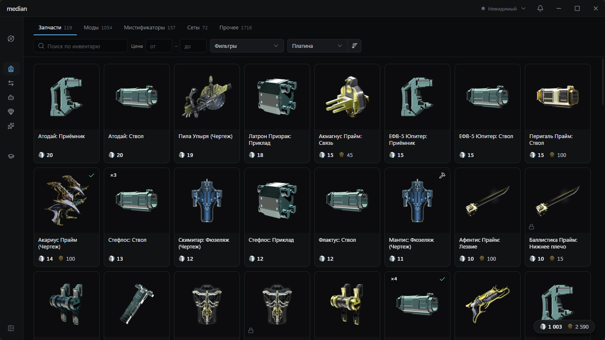

# median

Компаньон для Warframe.

[](https://github.com/Kwuuuwh/Median/releases/latest)
[](LICENSE)

**[Скачать](https://github.com/Kwuuuwh/Median/releases/latest)**



> [!IMPORTANT]
> Данные аккаунта median получает через свой коллектор в Overwolf. Для его установки требуется
> доступ разработчика Overwolf - см. [Начало работы](#начало-работы).

## О проекте

median является многофункциональным инструментом для игры Warframe, совмещающий в себе функционал множества сайтов: цены warframe.market, ценность реликвий, мировые таймеры, прогресс аккаунта и подсказывает где что можно получить.

## Возможности
- [x] Таймеры: циклы миров, разломы, торговцы, сбросы, уведомления.
- [x] Инвентарь с ценами warframe.market и фильтрацией
- [x] Ордера на warframe.market
- [x] Торговый агент
- [x] Реликвии
- [x] Каталог предметов
- [x] Мастерство и план освоения
- [x] Оверлей на экране наград реликвий
- [x] Оверлей при смене характеристик модов разлома
- [ ] Оценка стоимости модов разлома и аукционы

## Требования
- Windows 10 (2004 и новее) / Windows 11
- Warframe в оконном режиме / в окне без рамки
- Для данных аккаунта - Overwolf и доступ разработчика Overwolf

## Установка

Скачайте установщик со страницы [последнего выпуска](https://github.com/Kwuuuwh/Median/releases/latest) и
запустите; Канал - stable / preview выбирается в настройках приложения.

## Начало работы

1. При первом запуске median скачает необходимые файлы для своей работы.
2. Чтобы взаимодействовать с warframe.market, войдите в аккаунт кнопкой "Войти" в шапке окна.
3. Чтобы median видел ваш инвентарь, подключите коллектор:
    1. Получите доступ разработчика Overwolf - подайте [заявку на разработку приложения (любого)](https://dev.overwolf.com/ow-native/getting-started/project-roadmap);
    2. В Overwolf откройте Settings -> About -> Development options -> Load unpacked и выберите папку `%LOCALAPPDATA%\com.median.desktop\collector`.

## Не забанят ли за это?

median не изменяет игру и не читает её память. Он использует только то, что игра отдаёт сама: журнал отладки и изображение на экране - награды наград распознаются по картинке. Инвентарь приходит из Overwolf.

## Сборка из исходников

Требуются Rust 1.88+, Node.js 24 и pnpm 11.

```bash
pnpm install
pnpm tauri dev
```

Тесты: `cargo test --workspace` и `pnpm --filter @median/window test`.

## Лицензия

[MIT](LICENSE). Модель распознавания текста - `eslav_PP-OCRv5_mobile_rec` от PaddlePaddle под Apache-2.0, см. [`THIRD-PARTY.md`](crates/median-vision/assets/THIRD-PARTY.md).

median не связан с Digital Extremes, Overwolf и warframe.market.